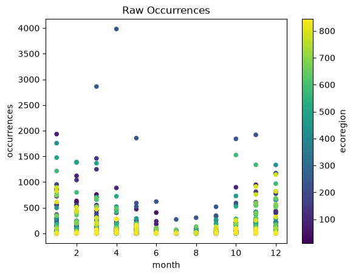
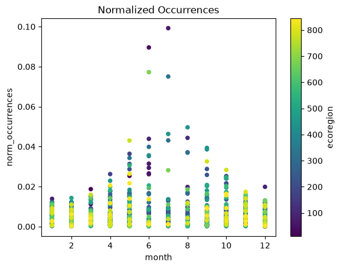

## Migration: Snow Geese
<iframe src="https://macaulaylibrary.org/asset/83406121/embed" height="550" width="640" frameborder="0" allowfullscreen></iframe>

>**Figure 1.** *Snow Goose*

The snow goose, or Anser caerulescens, includes two subspecies: the Lesser Snow Goose (Anser caerulescens caerulescens) 
and the Greater Snow Goose (Anser caerulescens atlanticus). The greater snow goose is slightly larger than the lesser 
snow goose and both subspecies are smaller than the Canadian goose. Reference materials vary in the highlighting and 
distinction or inclusion of the greater snow goose with discussions of the lesser snow goose, which is more abundant in 
population and wider spread in habitat. 

The snow goose is a medium-sized goose that weighs between 1.6 and 3.3 kg (3.5 – 7.3 lbs) and has a wingspan of 138 cm 
(~54 inches). Lesser snow geese have two colorations: white with black wingtips, called a white morph, or a white face 
with a dark brown body, called a blue morph. While blue morphs can occur among the greater snow geese, they are very uncommon, 
cited by Duffy et al as fewer than four percent of the population, to the point that some references state that the greater 
snow goose only has the white morph coloration. 

Snow geese spend their warm weather breeding season in the Arctic tundra including Alaska, northern Canada, Greenland, and Siberia. 
They migrate south for the winter and are generally observed to winter at sites that are close to the same longitude as their 
breeding grounds. Most snow geese spend their winters in North America, between the United States and Mexico, even those that 
summer in Russia. There are considered to be three separate regional groupings of snow geese. The eastern population is the only 
existing population of Greater Snow Geese. This group spends the winter on the East Coast of the United States and breeds in the 
Canadian High Arctic and the western coast of Greenland. The central population spends the winter in the U.S. Midwest and Gulf Coast 
and parts of eastern and central Mexico and breeds in arctic regions of Canada. The western population spends the winter in mostly in 
California and Mexico and breeds in northern Alaska, Canada, and Russia.

>**Figure 2.** *Snow Goose Distribution Map*
>
>Breeding (orange) / Migration (yellow) / Non-Breeding (Blue)
>
>BirdLife International (2021) Distribution map for Snow Goose Anser caerulescens. (https://www.allaboutbirds.org/guide/Snow_Goose/maps-range)

Global warming and climate change have been demonstrated to impact migratory birds by changing migration schedules as well as reducing availability or disrupting habitats and food sources. All of these factors can impact the populations and well-being of these migratory birds. Snow geese appear to not be experiencing the negative impacts of global warming and climate change to the same extent as other migratory species. Researchers report that snow goose populations continue to grow despite earlier thaws and that birds who have previously resided in the more southern breeding areas may be shifting their summering locations further north. Snow geese are less dependent upon "chasing the green wave" as they have bills that allow them to dig for buried plant matter if they arrive in an area before plants have sprouted. This ability paired with their voracious appetites and grazing habits mean that they can be more destructive to their habits, which could result in reduced viability of the habitats in the long run. It remains to be seen how long snow geese can continue to thrive in the face of global warming and climate change. 

Observation data taken from the Global Biodiversity Information Facility (GBIF) for snow geese in 2022 was used to evaluate migration patterns throughout the calendar year. The data was selected under the scientific name, Anser caerulescens, which includes both the lesser and the greater snow goose. The preliminary data set included 130,345 data points of observation month, latitude, and longitude. Using the latitude and longitude, the observations were mapped to ecoregions and any singular occurrences were removed from the data set to eliminate potential misidentifications. Mean observations were calculated by ecoregion and also by month. These mean values were used to normalize the occurrences by space and time. Figure 3 shows the raw distribution of occurrences and Figure 4 shows the normalized distribution of occurrences. Both of these plots use a color palette based on ecoregion. These plots show that the bulk of occurrences during the summer months are concentrated in just a few ecoregions while the occurrences are much more widely distributed across ecoregions during the winter months.  

>**Figure 3.** *Snow Goose Raw Occurrences by Ecoregion and Month*

>**Figure 4.** *Snow Goose Normalized Occurrences by Ecoregion and Month*
