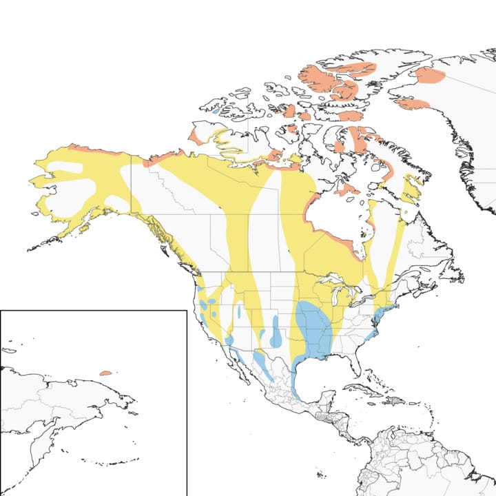

## Migration: Snow Geese
<iframe src="https://macaulaylibrary.org/asset/83406121/embed" height="550" width="640" frameborder="0" allowfullscreen></iframe>

>**Figure 1.** *Snow Goose*

The snow goose, or Anser caerulescens, includes two subspecies: the Lesser Snow Goose (Anser caerulescens caerulescens) 
and the Greater Snow Goose (Anser caerulescens atlanticus). The greater snow goose is slightly larger than the lesser 
snow goose and both subspecies are smaller than the Canadian goose. Reference materials vary in the highlighting and 
distinction or inclusion of the greater snow goose with discussions of the lesser snow goose, which is more abundant in 
population and wider spread in habitat. 

The snow goose is a medium-sized goose that weighs between 1.6 and 3.3 kg (3.5 – 7.3 lbs) and has a wingspan of 138 cm 
(~54 inches). Lesser snow geese have two colorations: white with black wingtips, called a white morph, or a white face 
with a dark brown body, called a blue morph. While blue morphs can occur among the greater snow geese, they are very uncommon, 
cited by Duffy et al as fewer than four percent of the population, to the point that some references state that the greater 
snow goose only has the white morph coloration. 

Snow geese spend their warm weather breeding season in the Arctic tundra including Alaska, northern Canada, Greenland, and Siberia. 
They migrate south for the winter and are generally observed to winter at sites that are close to the same longitude as their 
breeding grounds. Most snow geese spend their winters in North America, between the United States and Mexico, even those that 
summer in Russia. There are considered to be three separate regional groupings of snow geese. The eastern population is the only 
existing population of Greater Snow Geese. This group spends the winter on the East Coast of the United States and breeds in the 
Canadian High Arctic and the western coast of Greenland. The central population spends the winter in the U.S. Midwest and Gulf Coast 
and parts of eastern and central Mexico and breeds in arctic regions of Canada. The western population spends the winter in mostly in 
California and Mexico and breeds in northern Alaska, Canada, and Russia.

>**Figure 2.** *Snow Goose Distribution Map*
>
>Breeding (orange) / Migration (yellow) / Non-Breeding (Blue)
>
>BirdLife International (2021) Distribution map for Snow Goose Anser caerulescens. (https://www.allaboutbirds.org/guide/Snow_Goose/maps-range)

Global warming and climate change have been demonstrated to impact migratory birds by changing migration schedules as well as reducing 
availability or disrupting habitats and food sources. All of these factors can impact the populations and well-being of these migratory 
birds. Snow geese appear to not be experiencing the negative impacts of global warming and climate change to the same extent as other 
migratory species. Researchers report that snow goose populations continue to grow despite earlier thaws and potential mismatches between migration
times and food availability in the northern summer habitats. This is in part due to the fact that snow geese have voracious appetites and a 
destructive approach to feeding. Snow geese have bills that allow them to dig up plant roots, which makes their grazing highly destructive, 
particularly when the birds are present in numbers a large as those of migrating snow geese. Habitat damage from snow geese has already had negative
ecological impacts in some northern breeding grounds and birds who have previously resided in the more southern breeding areas have been observed to
be shifting their summering locations further north. Both the snow goose populations and the ecosystems they are impacting are being monitored by 
scientists and ecologists in efforts to balance what is best for the birds and the environment around them. 

Observation data taken from the Global Biodiversity Information Facility (GBIF) for snow geese in 2022 was used to evaluate migration patterns throughout the calendar year. The data was selected under the scientific name, Anser caerulescens, which includes both the lesser and the greater snow goose. The preliminary data set included 130,345 data points of observation month, latitude, and longitude. Using the latitude and longitude, the observations were mapped to ecoregions and any singular occurrences were removed from the data set to eliminate potential misidentifications. Mean observations were calculated by ecoregion and also by month. These mean values were used to normalize the occurrences by space and time. Figure 3 shows the normalized distribution of occurrences using a color palette based on ecoregion. The plots show that the bulk of occurrences during the summer months are concentrated in just a few ecoregions while the occurrences are much more widely distributed across ecoregions during the winter months.  

")
>**Figure 3.** *Snow Goose Normalized Occurrences by Ecoregion and Month in 2022*

Figure 3 inspired additional questions about the details of snow geese occurrences across ecoregions. Figure 4 shows the number of ecoregions with more than one occurrence reported for each month. This plot shows that the snow geese are observed in fewer regions during the summer breeding season. The geese are more distributed during the rest of the year, with the largest number of ecoregions evident during the migration months. Figure 5 shows the total number of occurrences collected for snow geese by month and color coded by ecoregion. This figure presents a similar shape to the ecoregion count plot of Figure 4, however, the takeaway of this figure, which is further supported by the interactive map in Figure 6 below, is that the months with the lowest number of occurrences are likely due to the remoteness of the ecoregions where the snow geese reside during this time. It is demonstrated that the snow geese are concentrated in a smaller number of ecoregions but it must be highlighted that many of these breeding season ecoregions are sparsely populated with humans, thus the volume of occurrence reporting will be considerably lower than when snow geese are present in their winter habitats, which are more often near or within higher population areas. The conclusions drawn from these figures are also captured in the interactive map of Figure 6, which provides a map based time-variable visualization of snow goose activity.

")
>**Figure 4.** *Monthly Count of Ecoregions with Snow Goose Occurrences in 2022*

")
>**Figure 5.** *Snow Goose Total Occurrences by Month in 2022*

The monthly grouped normalized occurrence data was plotted onto a map by ecoregion and a slider widget was applied to allow the user to step through the mapping of snow goose observation locations throughout the year. This interactive map is Figure 6. Comparison of the output of the interactive map with the Birdlife International map from the Cornell Lab All About Birds website (Figure 2) yields both alignment and differences. The occurrences in North America align reasonably well with the published map, however there are clusters of observations in countries that are not included in the Birdlife International map. There are snow goose occurrences in western and northern Europe as well as western Russia. There are additionally some months with observations in Iceland, Hawaii, Japan, China. While these populations are not addressed in many of the common resources on birds, the snow goose fact sheet on the BirdLife International data website included a distribution table that included many of these locations with the birds' presence identified as vagrant, or far outside its normal habitat grounds, for most countries and as introduced for the United Kingdom and Norway. In the distribution table, the countries where the snow goose is identified as native are United States, Canada, Mexico, Greenland, and Russia. Literature search identified a paper from 2022 (Mooij) that documented research into historical records regarding the presence of the lesser snow goose in Eurasia, which would suggest that there were, and could still be, suitable habitats for the snow geese in these regions where less frequent observations are reported. 

<embed type ="text/html" src ="img/migration_plot_snow_goose.html" width="800" height="800">
>**Figure 6.** *Map of Snow Goose Normalized Distribution of Occurrences by Month*

#### References
1. BirdLife. (n.d.). Snow Goose. Retrieved from Data Zone by BirdLife: https://datazone.birdlife.org/species/factsheet/snow-goose-anser-caerulescens
2. Cornell Lab. (n.d.). Snow Goose. Retrieved from Birds of the World: https://birdsoftheworld.org/bow/species/snogoo/cur/introduction
3. Duffy, G., Pierpont, N., & Martin, C. L. (2005). Migration Patterns & Routes of the Greater Snow Goose . New York Department of Public Service. Retrieved from https://documents.dps.ny.gov/public/Common/ViewDoc.aspx?DocRefId=%7B07500168-4F0A-45D1-8AA4-4C9A28D11CAC%7D
4. Gieger, O. (2023, Jun 1). What migrating birds can teach us about managing for climate change . Retrieved from U.S. Fish & Wildlife Service: https://www.fws.gov/story/2023-06/what-migrating-birds-can-teach-us-about-managing-climate-change
5. Mooij, J. H. (2022, November). Was the (Lesser Snow Goose (Anser c. caerulescens) once widespread in Eurasia? Goose Bulletin(28), 27-42. Retrieved from https://www.researchgate.net/publication/366723834_Was_the_Lesser_Snow_Goose_Anser_c_caerulescens_once_widespread_in_Eurasia
6. New Study Finds Delayed Long-Distance Bird Migration Due to Climate Change. (2025, Jul 22). Retrieved from Mass Audubon: https://www.massaudubon.org/news/press-room/2025/new-study-finds-delayed-long-distance-bird-migration-due-to-climate-change
7. Preston, E. (2020, Jan 13). Lack of Snow Is, Ironically, Helping Snow Geese. Retrieved from Hakai Magazine: https://hakaimagazine.com/news/lack-of-snow-is-ironically-helping-snow-geese/
8. Snow Goose. (n.d.). Retrieved from Audubon Bird Guide: https://www.audubon.org/field-guide/bird/snow-goose
9. Trent, S. (2025, Fall). Can Anything Stop the Explosion of Snow Geese in the Western Arctic? Retrieved 10 2026, from Audubon Magazine: https://www.audubon.org/magazine/can-anything-stop-explosion-of-snow-geese-western-arctic

[Link to the python code supporting this analysis](migration_notebook.html)

[Return to Main Page](index.md)

